# 🛡️ MergeGuard

<p align="center">
  <strong>Autonomous, Multi-Agent Pull Request Review & Deterministic Merge Gate</strong>
</p>

<p align="center">
  <a href="https://github.com/PiyushAgarwalcs/MergeGuard/actions/workflows/ci.yml">
    
  </a>
  
  
  
  
  
</p>

---

## 📌 Table of Contents

- [Overview](#-overview)
- [System Architecture](#-system-architecture)
- [Agent Team & Verification Flow](#-agent-team--verification-flow)
- [Key Highlights & Performance](#-key-highlights--performance)
- [Benchmark & Evaluation Suite](#-benchmark--evaluation-suite)
- [Live Demo & Output](#-live-demo--output)
- [Tech Stack](#-tech-stack)
- [Quick Start](#-quick-start)
- [Local LLM & Provider Configuration](#-local-llm--provider-configuration)
- [Dashboard & Observability](#-dashboard--observability)
- [Threat Model & Fail-Closed Philosophy](#-threat-model--fail-closed-philosophy)
- [Contributing & Technical Documentation](#-contributing--technical-documentation)

---

## 🔍 Overview

**MergeGuard** is a production-grade pull request safety gate built for Python codebases. It solves the critical flaw in naive LLM code-review bots: **hallucinations and inconsistency**.

Rather than letting an LLM unilaterally approve or block code, MergeGuard introduces a **fail-closed, defense-in-depth architecture**:
1. **Deterministic Pre-flight**: Parses diffs, redacts secrets, and scans for known CVE patterns before any LLM is called.
2. **LangGraph Agent Panel**: Dispatches 3 parallel reviewer agents (**Security**, **Correctness**, and **Test coverage**) followed by an adversarial **Skeptic** that challenges hallucinated or ungrounded findings.
3. **Line-Level Evidence Verification**: Mechanically validates that every finding references exact, un-redacted lines in the modified code.
4. **Deterministic Pure-Logic Judge**: Replaces LLM decision-making with a strict rule engine. If CI is missing, context is truncated, or a model fails, the review fails closed to `needs_human`.

---

## 📐 System Architecture

Each agent and pipeline stage is color-coded by responsibility:

```mermaid
flowchart LR
    %% Styling Classes
    classDef preproc fill:#f8fafc,stroke:#64748b,stroke-width:2px,color:#0f172a;
    classDef security fill:#fee2e2,stroke:#ef4444,stroke-width:2px,color:#991b1b;
    classDef correctness fill:#e0f2fe,stroke:#0284c7,stroke-width:2px,color:#075985;
    classDef testrev fill:#fef3c7,stroke:#f59e0b,stroke-width:2px,color:#92400e;
    classDef skeptic fill:#ede9fe,stroke:#8b5cf6,stroke-width:2px,color:#5b21b6;
    classDef verifier fill:#dcfce7,stroke:#10b981,stroke-width:2px,color:#065f46;
    classDef judge fill:#fef9c3,stroke:#ca8a04,stroke-width:2px,color:#713f12;
    classDef passDecision fill:#bbf7d0,stroke:#16a34a,stroke-width:2px,color:#14532d;
    classDef humanDecision fill:#fed7aa,stroke:#ea580c,stroke-width:2px,color:#7c2d12;
    classDef blockDecision fill:#fecaca,stroke:#dc2626,stroke-width:2px,color:#7f1d1d;
    classDef storage fill:#e2e8f0,stroke:#475569,stroke-width:1.5px,stroke-dasharray: 3 3,color:#1e293b;

    %% Ingestion
    PR["📄 PR Diff & CI"]:::preproc --> SCAN["⚙️ Parse, Redact &<br/>Rule Scanner"]:::preproc

    %% Agent Fan-Out
    SCAN --> SEC["🔴 Security Agent<br/><i>Injections · Auth · CVEs</i>"]:::security
    SCAN --> CORR["🔵 Correctness Agent<br/><i>Logic Bugs · AST Checks</i>"]:::correctness
    SCAN --> TEST["🟡 Test Agent<br/><i>Coverage · Sentinels</i>"]:::testrev

    %% Skeptic & Verification
    SEC --> SKEPTIC["🟣 Adversarial Skeptic<br/><i>Challenges Findings</i>"]:::skeptic
    CORR --> SKEPTIC
    TEST --> SKEPTIC

    SKEPTIC --> VERIFY["🟢 Evidence Verifier<br/><i>Line & Quote Checks</i>"]:::verifier
    SCAN -. Rule Findings .-> VERIFY

    %% Judge & Decisions
    VERIFY --> JUDGE{"⚖️ Deterministic<br/>Judge"}:::judge

    JUDGE --> PASS["✅ PASS"]:::passDecision
    JUDGE --> HUMAN["⚠️ NEEDS HUMAN"]:::humanDecision
    JUDGE --> BLOCK["🛑 BLOCK"]:::blockDecision

    %% Persistence
    HUMAN -. Checkpoint .-> STORE[("💾 SQLite Trace<br/>& Dashboard")]:::storage
    PASS -.-> STORE
    BLOCK -.-> STORE
```



---

## 🤖 Agent Team & Verification Flow

| Role | Color Badge | Core Responsibility | Why It's Isolated |
|:---|:---:|:---|:---|
| **Security Reviewer** | `🔴 Red` | Detects SQLi, command injection, path traversal, auth bypasses | Constrained schema & focused prompt lowers hallucinations |
| **Correctness Reviewer** | `🔵 Blue` | Detects subtle logic regressions, off-by-one errors, type errors | Decouples code bugs from security vulnerabilities |
| **Test Reviewer** | `🟡 Amber` | Inspects test changes, deletion of sentinels, missing edge cases | Prevents PRs from passing without verifiable test coverage |
| **Adversarial Skeptic** | `🟣 Purple` | Challenges reported findings against raw diff hunks | Removes false positives before they pollute the review |
| **Evidence Verifier** | `🟢 Green` | Mechanically validates diff lines & quotes (No LLM) | Cryptographically grounds findings against actual code |
| **Deterministic Judge** | `🟡 Gold` | Final decision logic based on verified findings and CI | Keeps LLMs out of the critical merge decision path |

---

## 🌟 Key Highlights & Performance

- **294 Passing Unit & Integration Tests**: Comprehensive automated test coverage spanning agents, graph routing, storage concurrency, and webhook delivery.
- **0% Unsafe-Pass Rate**: Evaluated on 39 must-catch security vulnerabilities (command injection, deserialization, secrets) — **zero** auto-approved.
- **100% Component Accuracy**: Validated on 706 deterministic component cases (diff parser, redactor, and verifier all score 1.000).
- **Statistically Grounded Ablation Study**: Tested across 6 pipeline variants with 1,000 paired bootstrap iterations; removing the deterministic rule layer caused a **38.9 percentage point drop in recall**.
- **Human-in-the-Loop Resumption**: Built on SQLite checkpointing. Human reviewers can issue `/approve`, `/override`, or `/dismiss` commands tied directly to the commit SHA.

---

## 📊 Benchmark & Evaluation Suite

MergeGuard includes an offline evaluation harness (`evals/run.py`) with **9 evaluation layers** and a **356-case golden dataset**:

### L1 Component Evaluation (706 Cases, Replay Mode)

All component acceptance bars passed with zero regressions:

| Component | Target Metric | Score | Bar Requirement | Status |
|:---|:---|:---:|:---:|:---:|
| `diff_parser` | Line & range accuracy | **100%** (1.000) | $\ge$ 1.00 | **Passed** |
| `secret_scanner` | Secret recall | **100%** (1.000) | $\ge$ 0.95 | **Passed** |
| `secret_scanner` | False positive rate | **0.0%** (0.000) | $\le$ 0.02 | **Passed** |
| `redactor` | Secret removal rate | **100%** (1.000) | $\ge$ 1.00 | **Passed** |
| `verifier` | Fabricated-finding acceptance rate | **0.0%** (0.000) | = 0.00 | **Passed** |
| `verifier` | Genuine-finding rejection rate | **0.0%** (0.000) | = 0.00 | **Passed** |
| `judge` | Truth-table accuracy | **100%** (1.000) | = 1.00 | **Passed** |
| `webhook` | Signature & delivery acceptance | **100%** (1.000) | = 1.00 | **Passed** |
| `context_collector` | Call-graph extraction accuracy | **100%** (1.000) | = 1.00 | **Passed** |
| **Pipeline Safety** | **Unsafe-pass rate (Must-catch diffs)** | **0% (0 / 39)** | **= 0%** | **Passed** |

---

## 💻 Live Demo & Output

Run MergeGuard locally against any diff file:

```bash
mergeguard review examples/flawed_shell.diff
```

```
━━━━━━━━━━━━━━━━━━━━━━━━━━━━━━━━━━━━━━━━━━━━━━━━━━━━━━━━━━━━━━━━━━━━━━━━
 🛡️ MergeGuard PR Review
━━━━━━━━━━━━━━━━━━━━━━━━━━━━━━━━━━━━━━━━━━━━━━━━━━━━━━━━━━━━━━━━━━━━━━━━
 Decision  │ needs_human
 Risk      │ high
 Findings  │ 1 verified issue
 CI Status │ passing
 Checkpoint│ 4f8d2e... (stored in SQLite)
━━━━━━━━━━━━━━━━━━━━━━━━━━━━━━━━━━━━━━━━━━━━━━━━━━━━━━━━━━━━━━━━━━━━━━━━

 runner.py:2  [command_injection · HIGH · deterministic_rule]
   +    return subprocess.run(user, shell=True)
   ─── shell=True with user-controlled input allows arbitrary command execution.
   ─── Evidence: verified against changed lines 1-2.

 ℹ️ Judge Escalation: High-severity finding requires human sign-off before merge.
```

---

## 🛠️ Tech Stack

| Layer | Framework / Tool | Purpose |
|:---|:---|:---|
| **Language** | Python 3.11+ | Core runtime and static typing |
| **Multi-Agent Orchestration** | LangGraph | State graph routing, parallel fan-out, and interruptible human gates |
| **Checkpoints & Persistence** | LangGraph SQLite Checkpointer | Resumable SHA-bound review state & event history |
| **Data Validation** | Pydantic v2 | Strict schema enforcement for LLM JSON outputs |
| **Webhook Ingestion** | FastAPI + Uvicorn | HMAC-SHA256 authenticated GitHub webhook server |
| **Observability Dashboard** | Streamlit + Plotly | Interactive analytics: confusion matrix, ablations, and live traces |
| **Static Code Quality** | Ruff, Black, Mypy | Enforced linting, zero formatting drift, and full type safety |
| **LLM Inference** | Ollama / Groq / OpenAI | Zero-cost local inference via Ollama or fast remote models via Groq |

---

## 🚀 Quick Start

### 1. Installation

```bash
# Clone the repository
git clone https://github.com/PiyushAgarwalcs/MergeGuard.git
cd MergeGuard

# Create and activate Python 3.11 virtual environment
python -m venv .venv
# On Windows:
.venv\Scripts\activate
# On Linux/macOS:
source .venv/bin/activate

# Install with developer dependencies
pip install -e ".[dev]"
```

### 2. Verify Installation & Tests

```bash
# Run the complete test suite (294 tests)
pytest tests -q

# Run the full quality check (linting, formatting, types)
make check
```

---

## ⚙️ Local LLM & Provider Configuration

MergeGuard defaults to `LLM_MODE=replay` for instant, offline verification without API keys.

To run live multi-agent reviews for free:

### Option A: Local Ollama (100% Offline & Free)
Install [Ollama](https://ollama.ai) and pull a supported model:
```bash
ollama run qwen3:1.7b
```
In your `.env` file:
```dotenv
LLM_PROVIDER=ollama
LLM_BASE_URL=http://localhost:11434/v1
LLM_API_KEY=
LLM_MODE=live
REVIEWER_MODEL=qwen3:1.7b
SKEPTIC_MODEL=qwen3:1.7b
JUDGE_MODEL=qwen3:1.7b
```

### Option B: Groq API (High Speed Free Tier)
Sign up for a free key at [console.groq.com](https://console.groq.com):
```dotenv
LLM_PROVIDER=groq
LLM_BASE_URL=https://api.groq.com/openai/v1
LLM_API_KEY=gsk_your_groq_key_here
LLM_MODE=live
REVIEWER_MODEL=llama-3.3-70b-versatile
SKEPTIC_MODEL=llama-3.3-70b-versatile
JUDGE_MODEL=llama-3.3-70b-versatile
```

---

## 📈 Dashboard & Observability

Launch the built-in analytics dashboard:

```bash
streamlit run dashboard/app.py
```

The dashboard includes 9 dedicated views:
- **Overview & KPI**: Real-time review metrics, pass/block distribution.
- **Pipeline & Slices**: Confusion matrices across the 12 vulnerability categories.
- **Case Explorer**: Detailed inspection of every diff hunk and agent finding.
- **Run Comparison**: Visual diff of metrics across git commits.
- **Ablation Studies**: Statistical bootstrap interval comparisons across 6 graph variants.
- **Consistency Analysis**: 5-repeat stochastic evaluation for agent decision agreement.
- **Live Traces**: Interactive audit log of decisions, findings, and human approvals.

---

## 🔒 Threat Model & Fail-Closed Philosophy

MergeGuard operates under zero-trust assumptions:
- **Prompt Injection via Diffs**: Diffs are treated as untrusted user data. Prompts strictly delimit diff blocks, and model outputs are constrained by Pydantic JSON schemas.
- **Fabricated Findings**: The Verifier rejects any finding that does not exactly match an edited file and hunk line number.
- **Fail-Closed Safety**: Any runtime timeout, token limit exhaustion, missing CI status, or model parsing error immediately routes to `needs_human`. No failure mode can result in an accidental `pass`.

Read the detailed [Threat Model Document](docs/threat-model.md) for complete specifications.

---

## 🤝 Contributing & Technical Documentation

- **[Architecture Decisions & Engineering Rationale](docs/architecture-decisions.md)**: Deep dive into design trade-offs, fail-closed safety mechanics, and multi-agent vs single-agent ablation findings.
- **[How It Works](docs/how-it-works.md)**: Execution flow, reviewer mechanics, and deterministic AST parsing details.
- **[Evaluation Methodology](docs/evaluation.md)**: Breakdown of all 9 evaluation layers, 356-case golden dataset, and regression gates.
- **[Threat Model & Security](docs/threat-model.md)**: Adversarial trust boundaries, diff prompt-injection defenses, and fail-closed policies.
- **[Contributing Guide](CONTRIBUTING.md)**: Local developer environment setup, testing standards, and pull request procedures.

---

<p align="center">
  Built with ❤️ for secure, automated, and explainable software delivery.
</p>
