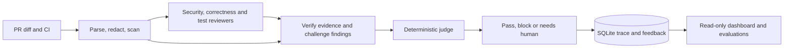

# MergeGuard

MergeGuard reviews Python pull requests with deterministic checks and focused agents, then applies a conservative, auditable merge decision.



## Quick start

Use Python 3.11 or newer. From the repository root:

```bash
python -m venv .venv
# Activate .venv for your shell, then:
python -m pip install -e .
mergeguard review examples/flawed_shell.diff
streamlit run dashboard/app.py
```

The default `LLM_MODE` is `replay`; no API key is needed for local setup. If no matching replay response is cached, reviewer calls are incomplete and the CLI reports `needs_human` (exit code 1). Deterministic checks still run. That result is a safe smoke check, not a full model review. To use a provider, set `LLM_MODE=live`, `LLM_BASE_URL`, `LLM_API_KEY`, `REVIEWER_MODEL` and `SKEPTIC_MODEL` in an ignored `.env` file. See `.env.example`.

The dashboard reads `data/mergeguard.db` by default. Set `DATABASE_PATH` to use another SQLite file. It can start with an empty database; the evaluation pages populate as saved runs are added.

### Use local Ollama

The Ollama provider uses the OpenAI-compatible endpoint and needs no API key. For the installed `qwen3:1.7b` model, set these values in `.env`:

```dotenv
LLM_PROVIDER=ollama
LLM_BASE_URL=http://localhost:11434/v1
LLM_API_KEY=
LLM_MODE=live
REVIEWER_MODEL=qwen3:1.7b
SKEPTIC_MODEL=qwen3:1.7b
JUDGE_MODEL=qwen3:1.7b
GENERATOR_MODEL=qwen3:1.7b
CROSS_CHECK_MODEL=
```

Leave `CROSS_CHECK_MODEL` blank to use the skeptic model for that optional role. MergeGuard sends constrained JSON schemas to Ollama, wrapping list schemas for its object-root JSON schema interface and validating the returned items with Pydantic.

### Optional Groq fallback

If local Ollama quality or speed is insufficient, Groq can use the same OpenAI-compatible client with strict JSON Schema output. Set `LLM_PROVIDER=groq`, `LLM_BASE_URL=https://api.groq.com/openai/v1`, `LLM_API_KEY` to a Groq API key, and the model roles to a currently supported Groq model such as `openai/gpt-oss-20b`. See [Groq structured outputs](https://console.groq.com/docs/structured-outputs) and [supported models](https://console.groq.com/docs/models).

## Results

The first saved baseline contains a full replay evaluation snapshot. The pipeline row below comes from the recorded `v0.1` test split, 144 cases, in **stub** mode without live model calls. Values are from the persisted SQLite evaluation run; the baseline snapshot is in `evals/baselines/main.json`.

| Dataset | Model mode | Split | Finding recall | False findings per clean PR | Unsafe-pass rate | Decision agreement | p95 latency | Cost per PR |
|---|---|---|---:|---:|---:|---|---:|---:|
| v0.1 | stub | test (144 cases) | 50.8% | 0.04 (1 finding / 23 hard-negative and presumed-clean cases) | 0% (0/39 must-catch cases) | not yet measured | 0.0805 s | $0.00 |

This offline run sent no cases to an LLM. All 144 pipeline decisions were `needs_human` because CI was unavailable; the over-escalation rate was 100%. These figures describe deterministic scanner and fail-closed behavior, not live model quality. Judge calibration is also uncalibrated because no human-scored calibration set has been entered.

## Evaluation and dashboard

Run the checks and replay suites from the repository root:

```bash
make check
python -m evals.run --layer components --mode replay
python -m evals.run --layer integration --mode replay
python -m evals.run --layer pipeline --split test --mode replay
python -m evals.run gate
```

Use the `dev` split for tuning and the `test` split for reports. Save an intentional baseline update with `python -m evals.run baseline save`. Dashboard pages show evaluation layers, pipeline slices, case details, run comparisons, consistency, ablations, cost and latency, dataset coverage, judge calibration, and live review traces. See [evaluation instructions](docs/evaluation.md) for every layer and dashboard page.

In the measured stub ablation, `single_agent` matched the full team on recall (0.451), precision (0.687), and unsafe-pass rate (0). Removing rules reduced recall by 0.389. Scripted reviewers return empty findings in this experiment, so the deterministic scanner drives the result; these values do not show that a live single-agent system matches the team.

## Limits and non-goals

MergeGuard supports Python pull requests. It reads diffs and CI status but never checks out or executes pull-request code. Missing CI, incomplete diffs, reviewer failures, and unavailable model responses require a human. Deterministic scanning and model review can miss defects or raise false findings. Configure branch protection to require the `mergeguard` commit status; MergeGuard does not auto-merge. Live reviews send repository context to the configured provider. Review [the threat model](docs/threat-model.md) before enabling live access or GitHub publishing.

For local architecture and end-to-end GitHub setup, see [How it works](docs/how-it-works.md) and the operational guidance in [the threat model](docs/threat-model.md).
