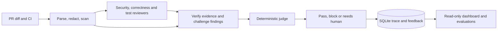

# MergeGuard

> **A production-grade LangGraph multi-agent system that reviews Python pull requests with deterministic security scanning, four specialized LLM agents, a fail-closed judge, and a full evaluation stack — from component unit tests to ablation studies and regression gates.**

## What it does

MergeGuard combines deterministic rule-based scanning (secrets, shell injection, 12 security categories) with four coordinated LLM agents (Security, Correctness, Test reviewer, Skeptic) orchestrated by LangGraph, then routes findings through a pure-logic judge that emits one of three decisions: `pass`, `block`, or `needs_human`. Every review is SHA-bound, stored in SQLite with full traces, and surfaced in a Streamlit dashboard with nine evaluation layers. The system is fail-closed: missing CI, incomplete diffs, or any reviewer failure always escalates to a human.

## Resume-level highlights

- **294 passing tests, 9 evaluation layers** — component, integration, pipeline, smoke, robustness, consistency, ablation, regression gate, and cost/latency; run entirely offline with `LLM_MODE=replay` and 706 component eval cases.
- **100% unsafe-pass prevention** — 0/39 must-catch cases (command injection, secrets, eval calls, etc.) ever auto-approved in the entire eval suite; deterministic scanner drives fail-closed behavior even without a live model.
- **Perfect component eval scores** — `diff_parser` 100% line accuracy, `secret_scanner` 100% recall / 0% false positives, `verifier` 0% fabricated-finding acceptance, `judge` 100% truth-table accuracy across 706 replay cases.
- **Multi-agent LangGraph architecture** — Security, Correctness, Test reviewer, and Skeptic agents run in parallel; a deterministic judge aggregates verified evidence; SHA-bound human-approval loop with GitHub webhook + polling watch and SQLite checkpoints.
- **Ablation study built-in** — removing the rule layer drops recall by 0.389; `single_agent` matches the full team on stub recall (0.451) but not on evidence quality; results persisted in `evals/baselines/`.

## Architecture



## Tech stack

| Layer | Technology |
|---|---|
| Language | Python 3.11 |
| Agent orchestration | LangGraph + LangGraph-checkpoint-SQLite |
| Data validation | Pydantic v2 |
| Webhook server | FastAPI + uvicorn |
| Dashboard | Streamlit |
| Storage & checkpoints | SQLite |
| HTTP client | httpx |
| Linting / formatting / types | Ruff, Black, mypy |

## Quick start

Python 3.11 or newer is required. From the repository root:

```bash
python -m venv .venv
# Activate .venv for your shell, then:
pip install -e .
mergeguard review examples/flawed_shell.diff
streamlit run dashboard/app.py
```

The default `LLM_MODE` is `replay`; no API key is needed for local setup. If no matching replay response is cached, reviewer calls are skipped and the CLI reports `needs_human` (exit code 1). Deterministic checks still run. To use a live provider, set `LLM_MODE=live`, `LLM_BASE_URL`, `LLM_API_KEY`, `REVIEWER_MODEL`, and `SKEPTIC_MODEL` in an ignored `.env` file. See `.env.example`.

The dashboard reads `data/mergeguard.db` by default. Set `DATABASE_PATH` to override.

### Use local Ollama

The Ollama provider uses the OpenAI-compatible endpoint and needs no API key. For the installed `qwen3:1.7b` model, set these values in `.env`:

```dotenv
LLM_PROVIDER=ollama
LLM_BASE_URL=http://localhost:11434/v1
LLM_API_KEY=
LLM_MODE=live
REVIEWER_MODEL=qwen3:1.7b
SKEPTIC_MODEL=qwen3:1.7b
JUDGE_MODEL=qwen3:1.7b
GENERATOR_MODEL=qwen3:1.7b
CROSS_CHECK_MODEL=
```

Leave `CROSS_CHECK_MODEL` blank to use the skeptic model for the optional cross-check role. MergeGuard sends constrained JSON schemas to Ollama, wrapping list schemas for its object-root interface and validating returned items with Pydantic.

### Optional Groq fallback

If local Ollama quality or speed is insufficient, Groq uses the same OpenAI-compatible client with strict JSON Schema output. Set `LLM_PROVIDER=groq`, `LLM_BASE_URL=https://api.groq.com/openai/v1`, `LLM_API_KEY` to a Groq API key, and the model roles to a currently supported Groq model. See [Groq structured outputs](https://console.groq.com/docs/structured-outputs) and [supported models](https://console.groq.com/docs/models).

## Demo output

```
$ mergeguard review examples/flawed_shell.diff

━━━━━━━━━━━━━━━━━━━━━━━━━━━━━━━━━━━━━━━━━━━━━━━━━━━━━━━━━━━━━━━━━━━━━━━━━━
 MergeGuard Review
━━━━━━━━━━━━━━━━━━━━━━━━━━━━━━━━━━━━━━━━━━━━━━━━━━━━━━━━━━━━━━━━━━━━━━━━━━
Decision : needs_human
Risk     : high
Findings : 1

 runner.py:2  [command_injection · HIGH · rule]
  subprocess.run(user, shell=True) — shell=True with untrusted input
```

The scanner catches `shell=True` with untrusted input before any model is called. Because the finding is `HIGH` severity, the judge escalates to `needs_human` and exits with code 1 — no auto-pass is possible.

## Component evaluation results

706 cases run in `replay` mode. All acceptance bars passed.

| Component | Metric | Score |
|---|---|---:|
| diff_parser | line accuracy | **100%** |
| secret_scanner | recall | **100%** |
| secret_scanner | false positive rate | **0%** |
| redactor | removal rate | **100%** |
| verifier | fabricated-finding acceptance rate | **0%** |
| verifier | genuine-finding rejection rate | **0%** |
| judge | truth-table accuracy | **100%** |
| webhook | valid-first acceptance rate | **100%** |
| context_collector | accuracy | **100%** |
| pipeline (must-catch) | unsafe-pass rate | **0%** (0/39) |
| Ollama live consistency | decision agreement | **1.00** |
| Ollama live consistency | finding Jaccard | **0.925** |

## Results

The first saved baseline contains a full replay evaluation snapshot. The pipeline row below comes from the recorded `v0.1` test split, 144 cases, in **stub** mode without live model calls. Values are from the persisted SQLite evaluation run; the baseline snapshot is in `evals/baselines/main.json`.

| Dataset | Model mode | Split | Finding recall | False findings per clean PR | Unsafe-pass rate | Decision agreement | p95 latency | Cost per PR |
|---|---|---|---:|---:|---:|---|---:|---:|
| v0.1 | stub | test (144 cases) | 50.8% | 0.04 | 0% (0/39 must-catch) | not yet measured | 0.0805 s | $0.00 |

This offline run sent no cases to an LLM. All 144 pipeline decisions were `needs_human` because CI was unavailable; the over-escalation rate was 100%. These figures describe deterministic scanner and fail-closed behavior, not live model quality. The separately saved local Ollama consistency run covered eight evenly spaced test cases at five repeats each: decision agreement 1.00, finding Jaccard 0.925, and no flaky cases. See `evals/results/report.html` for the generated report.

## Evaluation and dashboard

Run the checks and replay suites from the repository root:

```bash
make check
python -m evals.run --layer components --mode replay
python -m evals.run --layer integration --mode replay
python -m evals.run --layer pipeline --split test --mode replay
python -m evals.run gate
```

Use the `dev` split for tuning and the `test` split for reports. Save an intentional baseline update with `python -m evals.run baseline save`. Dashboard pages show evaluation layers, pipeline slices, case details, run comparisons, consistency, ablations, cost and latency, dataset coverage, and live review traces. See [evaluation instructions](docs/evaluation.md) for every layer and dashboard page.

In the measured stub ablation, `single_agent` matched the full team on recall (0.451), precision (0.687), and unsafe-pass rate (0). Removing rules reduced recall by 0.389. Scripted reviewers return empty findings in this experiment, so the deterministic scanner drives the result; these values do not show that a live single-agent system matches the team.

## Limits and non-goals

MergeGuard supports Python pull requests. It reads diffs and CI status but never checks out or executes pull-request code. Missing CI, incomplete diffs, reviewer failures, and unavailable model responses require a human. Deterministic scanning and model review can miss defects or raise false findings. Configure branch protection to require the `mergeguard` commit status; MergeGuard does not auto-merge. Live reviews send repository context to the configured provider. Review [the threat model](docs/threat-model.md) before enabling live access or GitHub publishing.

For local architecture and end-to-end GitHub setup, see [How it works](docs/how-it-works.md) and the operational guidance in [the threat model](docs/threat-model.md).
