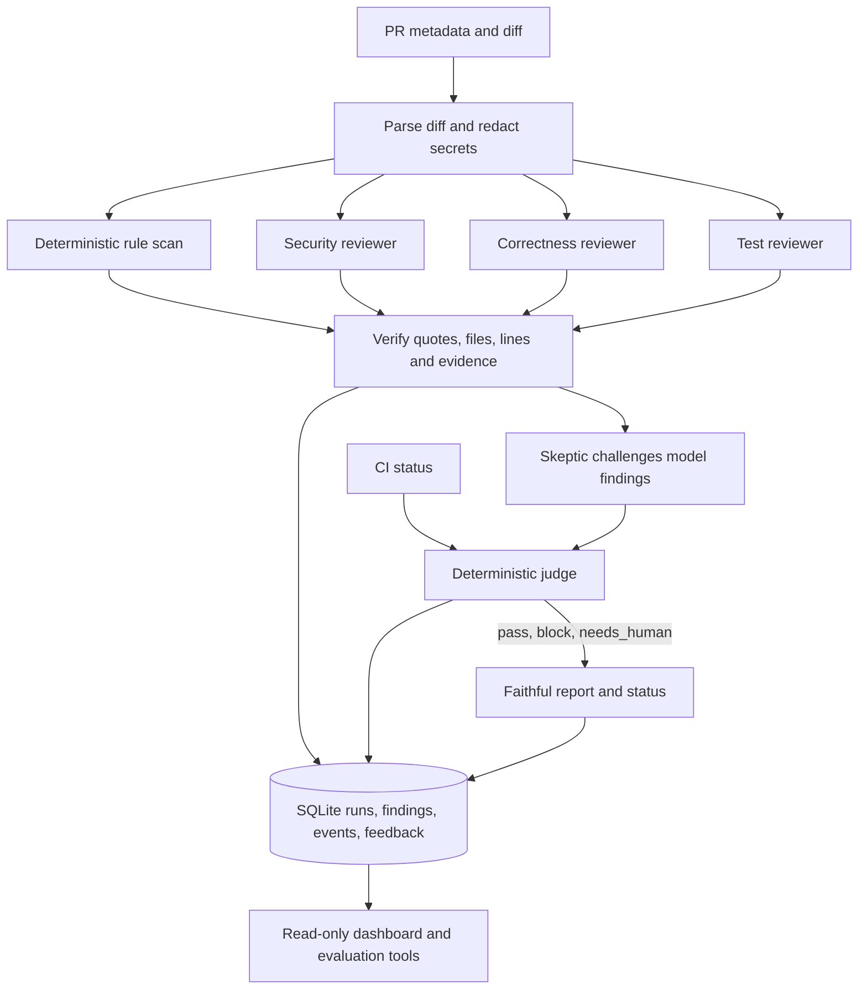

# How MergeGuard works

MergeGuard reads a pull request diff and CI status, runs deterministic checks and focused reviewers, then makes a conservative decision. It stores enough state in SQLite to inspect and resume reviews.

## Review flow

The diff parser tracks changed lines and file paths. Secret patterns are redacted before reviewer calls. The rule scanner and the security, correctness, and test reviewers run independently. Model output is schema checked, then every reported finding must match a changed file, a valid line range, and quoted diff evidence. The skeptic may challenge model findings; deterministic rule findings are not sent to it. The final judge applies fixed rules: critical verified findings block, incomplete reviews or missing/failing CI require a human, and only complete reviews with passing CI and no blocking risk can pass.

The reporter renders only findings that survived verification and includes exact citations. On GitHub, MergeGuard posts one status and one marked comment. A configured approver can approve, override, or dismiss a finding. Actions are recorded and approvals are tied to the reviewed commit SHA. LangGraph checkpoints are stored in the same SQLite database for resume.

## Modes and storage

Local review needs no GitHub token. `LLM_MODE=replay` uses recorded provider responses when present; tests also use scripted fake clients. Without a usable reviewer, the graph records an incomplete result and fails closed to `needs_human`. `LLM_MODE=live` sends review context to the configured provider. `LLM_PROVIDER=ollama` enables Ollama's OpenAI-compatible endpoint without a required API key and sends Pydantic schemas as constrained JSON output. `LLM_PROVIDER=groq` uses Groq's OpenAI-compatible endpoint with strict JSON Schema output for a supported model. The dashboard opens the database read-only; CLI review, evaluation, feedback, and checkpoints write to it.

Review traces include decisions, events, findings, model metadata and human feedback. The dashboard includes operational review runs as well as saved evaluation runs. See [the threat model](threat-model.md) before enabling live model calls or GitHub publishing.
